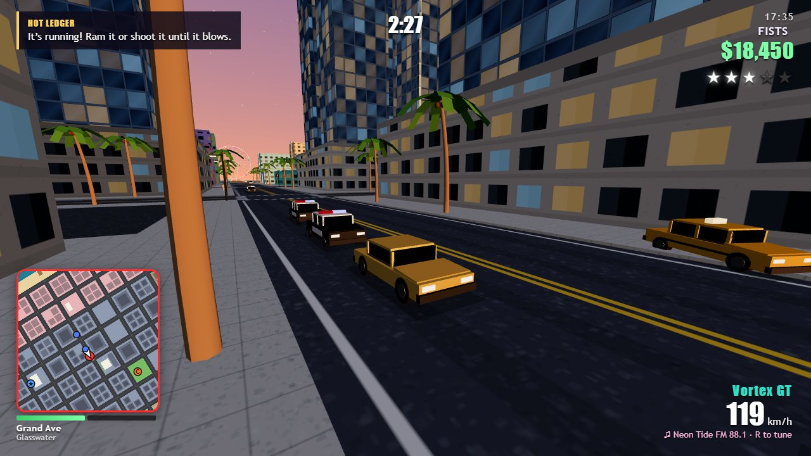

# Salt & Neon — a Palmera Bay story

[](https://make.fun/c/gta6-01)
[](https://make.fun/c/gta6-01)
[](https://make.fun/c/gta6-01)

An original open-world crime game that runs offline in a desktop browser. Sol Vega walks out of prison into **Palmera Bay** — a sun-soaked coastal city of glass towers, pastel beach hotels, harbour cranes and neon — and finds her family owes the Gilded Hand syndicate.



## Play

```
node serve.ts        # then open http://localhost:8080
```

| Key | Action |
| --- | --- |
| W A S D | Move / drive |
| Mouse | Look and aim |
| Shift / Space | Sprint / jump, handbrake in a car |
| F | Enter, steal or leave a car |
| Left / right mouse | Shoot or punch / aim over the shoulder |
| Q E, wheel, 1–4 | Switch weapon · R reloads (radio station in a car) |
| E | Start missions, shop, save · H horn · G siren · M map · Esc pause |

## What's in it

- **City**: five districts (Glasswater downtown, Palmera Beach, Old Harbor, Coral Heights, Saltmarsh), Fountain Park, the beach, the Sunwheel pier, day/night cycle with golden hour and lit windows.
- **Life**: lane-following AI traffic that turns, brakes and honks; pedestrians who walk, cross, flee and get run over; parked cars in lots.
- **Cars**: eight original models (Vortex GT, Marlin, Paloma Coupe, Tidewater Van, Dune Hopper, Bay Cab, PBPD Interceptor, Bastion), arcade physics with handbrake drifts, damage, smoke, fire and explosions.
- **Police**: five-star wanted level, dispatched patrol cars and riot vans that chase and ram, officers who arrest or open fire, line-of-sight search with fading stars, BUSTED and WASTED.
- **Story**: five missions — Homecoming, Two-Tone Job, Collection Day, Hot Ledger, The Gilded Hand.
- **Activities**: two street races, Bay Couriers deliveries, 15 hidden Sun Tokens, Bayside Arms gun counter, Fresh Coat respray, health and armour pickups.
- **Polish**: rotating minimap with GPS route, full map, objectives and timers, subtitles, synthesised sound effects, engine and sirens, three generated radio stations, title and pause menus, save/load.

All names, characters, art, sound and music are original; nothing is taken from any commercial game.

## Layout

`game/src/world` builds the city, `entities` the people and cars, `ai` the drivers, `systems` police, combat, missions, activities, audio and saving, `ui` the HUD and menus, `story` the script. `main.ts` hands the game in for make.fun.

MIT licensed.
